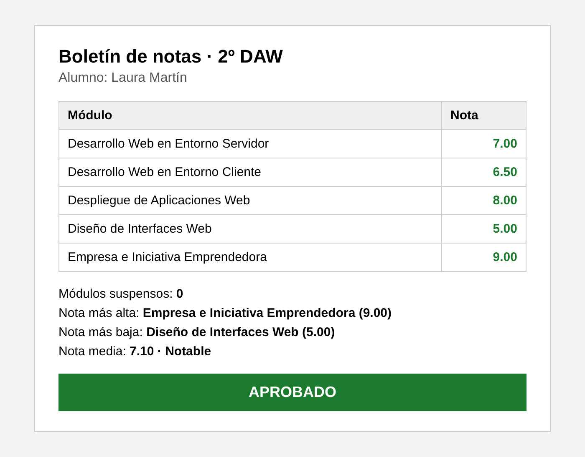

# Ejercicio 1: Boletín de notas de 2º DAW (1.5 puntos)

## Descripción

Al final de la evaluación, el centro necesita generar el boletín de un alumno de 2º de Desarrollo de Aplicaciones Web. Tu trabajo es programar la lógica que calcula su resultado y mostrarlo en una página web.

El ejercicio se resuelve en `index.php`, con los estilos en `assets/css/styles.css` (ya vinculado).

He añadido bootstrap y bootstrap-icons por si queréis usarlos. Ya están vinculados. En caso de no querer, solo debéis comentar/eliminar los links css en el head.

---

## Estructura de archivos

```
/EJ1
├── index.php
├── datos.php
├── README.md
├── assets/
│   ├── css/
│   │   └── styles.css
│   └── img/
├── partials/
└── controllers/
```

---

## Datos de entrada

El archivo `datos.php` ya contiene las variables con el alumno y sus notas. Se incluye en `index.php` con `require`:

```php
$alumno = "Laura Martín";

$notaServidor   = 7;     // Desarrollo Web en Entorno Servidor
$notaCliente    = 6.5;   // Desarrollo Web en Entorno Cliente
$notaDespliegue = 8;     // Despliegue de Aplicaciones Web
$notaInterfaces = 5;     // Diseño de Interfaces Web
$notaEmpresa    = 9;     // Empresa e Iniciativa Emprendedora
```

Tu programa debe funcionar cambiando solo estos valores. Las notas van de 0 a 10 y pueden tener decimales.

---

## Reglas

**1. Nota media**

Es la media de las cinco notas, redondeada a 2 decimales.

**2. Calificación de la media**

| Media | Calificación |
|---|---|
| Menos de 5 | Insuficiente |
| De 5 a menos de 6 | Suficiente |
| De 6 a menos de 7 | Bien |
| De 7 a menos de 9 | Notable |
| 9 o más | Sobresaliente |

**3. Resultado del curso**

- **Aprobado:** todos los módulos tienen una nota de 5 o más.
- **Pendiente de recuperación:** la media es 5 o más, hay al menos un módulo suspenso, pero **ninguna nota es inferior a 4**.
- **Suspendido:** cualquier otro caso.

---

## Qué debe mostrar la página

1. El nombre del alumno y una tabla con los cinco módulos y su nota. Las notas aprobadas se ven en verde y las suspensas en rojo.
2. El número de módulos suspensos.
3. El módulo con la **nota más alta** y el módulo con la **nota más baja** (nombre y nota). Si hay empate, muestra el primero que aparezca en la lista.
4. La nota media con su calificación.
5. El resultado del curso, destacado visualmente con un color distinto para cada uno de los tres casos.

---

## Diseño orientativo

Así podría verse el boletín. Es solo una referencia: no se valora el diseño, solo que la información sea clara.



---

## Casos para probar tu programa

| Servidor | Cliente | Despliegue | Interfaces | Empresa | Media | Resultado |
|---|---|---|---|---|---|---|
| 7 | 6.5 | 8 | 5 | 9 | 7.10 (Notable) | Aprobado |
| 8 | 4.5 | 6 | 7 | 5.5 | 6.20 (Bien) | Pendiente de recuperación |
| 3 | 9 | 8 | 7 | 9 | 7.20 (Notable) | Suspendido |
| 4 | 4 | 5 | 3.5 | 2 | 3.70 (Insuficiente) | Suspendido |

---

## Requisitos técnicos

- Usa `<?= ?>` para pintar valores y la sintaxis alternativa de PHP (`if(): elseif(): else: endif;`) dentro del HTML.
- Toda la lógica y los cálculos van **antes** del HTML.
- No se pueden usar arrays en este ejercicio.
- Las notas y la media se muestran siempre con 2 decimales.
- No se valora el diseño más allá de que sea claro y legible. Lo importante es la lógica.

---

## Entrega

Carpeta del ejercicio completa, con `index.php`, `datos.php` y `assets/`.
