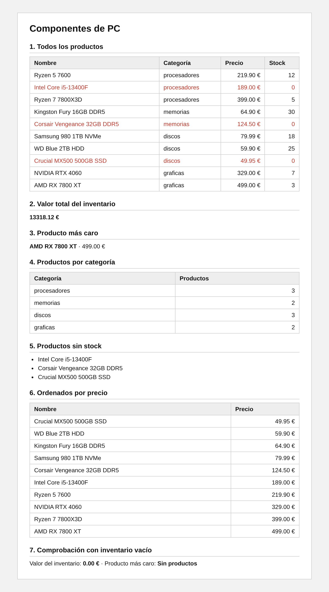

# Ejercicio 2: Inventario de una tienda de componentes de PC (2'5 puntos)

## Descripción

Una tienda de componentes informáticos necesita analizar su inventario. Tu trabajo es programar varias funciones que procesen el array de productos y mostrar los resultados en una página web.

Las funciones se escriben en `funciones.php`, se llaman desde `index.php` y los resultados se pintan en HTML. La página no tiene formularios: las llamadas a las funciones las escribes tú directamente en el código.

He añadido bootstrap y bootstrap-icons por si queréis usarlos. Ya están vinculados. En caso de no querer, solo debéis comentar/eliminar los links css en el head.

---

## Estructura de archivos

```
/EJ2
├── index.php
├── datos.php
├── funciones.php
├── README.md
├── assets/
│   ├── css/
│   │   └── styles.css
│   └── img/
├── partials/
└── controllers/
```

---

## Datos de entrada

El archivo `datos.php` ya contiene el array `$productos`. Cada producto es un array con `nombre`, `categoria`, `precio` y `stock`:

```php
["nombre" => "Ryzen 5 7600", "categoria" => "procesadores", "precio" => 219.90, "stock" => 12],
```

---

## Funciones a programar

Todas se escriben en `funciones.php` y reciben el array de productos como parámetro. **No pueden usar variables globales.**

| Función | Qué devuelve |
|---|---|
| `valorInventario($productos)` | La suma de `precio × stock` de todos los productos |
| `productoMasCaro($productos)` | El producto (el array completo) con el precio más alto. Si el array está vacío, devuelve `null` |
| `agruparPorCategoria($productos)` | Un array con cada categoría como clave y el número de productos que tiene como valor. Ejemplo: `["discos" => 3, "memorias" => 2]` |
| `productosSinStock($productos)` | Un array solo con los productos cuyo stock es 0 |
| `ordenarPorPrecio($productos)` | Un array con todos los productos ordenados de menor a mayor precio |

Condiciones:

- `ordenarPorPrecio` no debe modificar el array original: `$productos` se muestra sin ordenar en la primera tabla.
- Con un array vacío, `valorInventario` devuelve 0 y el resto de funciones que devuelven arrays devuelven un array vacío. Ninguna debe provocar avisos de PHP.

---

## Qué debe mostrar la página

1. Una tabla con **todos los productos** en el orden original: nombre, categoría, precio y stock. Los productos sin stock se ven en rojo.
2. El **valor total del inventario**.
3. El **producto más caro** (nombre y precio).
4. Una tabla con las **categorías** y el número de productos de cada una.
5. Una lista con los **productos sin stock**. Si no hay ninguno, un mensaje que lo indique.
6. Una tabla con los productos **ordenados por precio** de menor a mayor.
7. Una línea de comprobación al final: el resultado de llamar a `valorInventario([])` y a `productoMasCaro([])`. Si devuelve `null`, la página muestra "Sin productos".

---

## Diseño orientativo

Así podría verse la página. Es solo una referencia: no se valora el diseño, solo que la información sea clara.



---

## Resultados esperados con los datos dados

| Dato | Valor |
|---|---|
| Valor total del inventario | 13318.12 € |
| Producto más caro | AMD RX 7800 XT (499.00 €) |
| Categorías | procesadores: 3, memorias: 2, discos: 3, graficas: 2 |
| Productos sin stock | Intel Core i5-13400F, Corsair Vengeance 32GB DDR5, Crucial MX500 500GB SSD |
| Primero y último ordenados por precio | Crucial MX500 500GB SSD (49.95 €) y AMD RX 7800 XT (499.00 €) |

---

## Requisitos técnicos

- Usa `<?= ?>` para pintar valores y la sintaxis alternativa de PHP (`foreach(): endforeach;`, `if(): endif;`) dentro del HTML.
- Toda la lógica y las llamadas a las funciones van **antes** del HTML.
- Los precios y el valor del inventario se muestran siempre con 2 decimales y el símbolo €.
- Cada función hace una sola cosa y no pinta nada: devuelve el resultado y es `index.php` quien lo muestra.
- No se valora el diseño más allá de que sea claro y legible. Lo importante es la lógica.

---

## Entrega

Carpeta del ejercicio completa, con `index.php`, `datos.php`, `funciones.php` y `assets/`.
