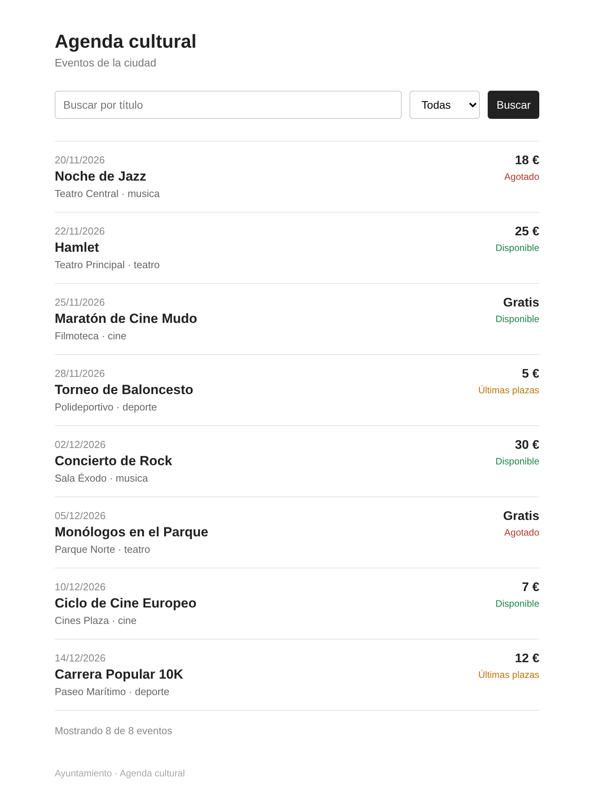

# Ejercicio 3: Agenda cultural (3 puntos)

## Descripción

El ayuntamiento quiere publicar la agenda cultural de la ciudad. Tu trabajo es construir una página con el listado de eventos, un buscador y componentes compartidos mediante partials.

---

## Estructura de archivos

```
/EJ3
├── index.php
├── datos.php
├── README.md
├── assets/
│   ├── css/
│   │   └── styles.css
│   └── img/
├── partials/
│   ├── header.php
│   ├── footer.php
│   └── tarjeta.php
└── controllers/
```

---

## Datos de entrada

El archivo `datos.php` ya contiene el array `$eventos`. Cada evento es un array con `id`, `titulo`, `categoria`, `fecha`, `lugar`, `precio`, `aforo` y `vendidas` (entradas vendidas):

```php
["id" => 1, "titulo" => "Noche de Jazz", "categoria" => "musica", "fecha" => "2026-11-20", "lugar" => "Teatro Central", "precio" => 18, "aforo" => 200, "vendidas" => 200],
```

---

## Partials

- `header.php` y `footer.php` se incluyen en `index.php` con `require`. Ya traen la estructura básica del HTML y el CSS vinculado. Complétalos con el contenido que quieras.
- `tarjeta.php` **no es una función**: es un archivo que se incluye con `include` **dentro del `foreach`** de `index.php` y usa la variable `$evento` que existe en ese momento.

---

## Qué debe mostrar la página

### 1. La tarjeta de cada evento

Cada evento se muestra con `partials/tarjeta.php` y debe incluir:

- Título y categoría
- Fecha en formato `dd/mm/aaaa` (por ejemplo, `2026-11-20` se muestra como `20/11/2026`)
- Lugar
- Precio: si es 0 se muestra "Gratis", si no, el precio con el símbolo €
- Un **estado**, según las entradas que quedan:
  - **Agotado** si las entradas vendidas igualan al aforo
  - **Últimas plazas** si quedan menos del 15 % del aforo disponible
  - **Disponible** en cualquier otro caso

### 2. El buscador

Un formulario con método **GET** y dos campos:

- `q`: campo de texto. Busca dentro del **título**, sin distinguir mayúsculas de minúsculas.
- `categoria`: desplegable con la opción "Todas" y las cuatro categorías.

Condiciones:

- Los dos filtros se **combinan**: si hay texto y categoría, el evento debe cumplir ambos.
- Si un filtro está vacío o es "Todas", no se aplica.
- Después de buscar, el formulario **mantiene** los valores que se introdujeron.
- Si ningún evento cumple los filtros, se muestra un mensaje que lo indique.
- Al entrar por primera vez, sin parámetros en la URL, se muestran todos los eventos y **no aparece ningún aviso de PHP**.

### 3. Resumen

Al final del listado, una línea con el texto `Mostrando X de Y eventos`, donde X son los eventos que cumplen los filtros e Y el total.

---

## Diseño orientativo

Así podría verse la página. Es solo una referencia: se pide un diseño sencillo y limpio, y no se valora más allá de que sea legible.



---

## Casos para probar tu programa

| Búsqueda (`q`) | Categoría | Eventos mostrados |
|---|---|---|
| (vacío) | Todas | 8 |
| `CINE` | Todas | 2 (Maratón de Cine Mudo y Ciclo de Cine Europeo) |
| (vacío) | musica | 2 (Noche de Jazz y Concierto de Rock) |
| `jazz` | teatro | 0, se muestra el mensaje de "sin resultados" |

Con los datos originales, los estados son:

| Evento | Estado |
|---|---|
| Noche de Jazz, Monólogos en el Parque | Agotado |
| Torneo de Baloncesto, Carrera Popular 10K | Últimas plazas |
| Los otros cuatro | Disponible |

---

## Requisitos técnicos

- Usa `<?= ?>` para pintar valores y la sintaxis alternativa de PHP (`foreach(): endforeach;`, `if(): endif;`) dentro del HTML.
- El filtrado se hace **antes del HTML**, en `index.php`: construye un array con los eventos que cumplen los filtros y el HTML solo recorre ese array.
- La lógica de la tarjeta (estado, precio, fecha) va al principio de `tarjeta.php`, antes de su HTML.
- No se puede usar `tarjeta.php` como función ni copiar su contenido dentro de `index.php`.
- Diseño sencillo y limpio. Lo importante es la lógica.

---

## Entrega

Carpeta del ejercicio completa, con `index.php`, `datos.php`, `partials/` y `assets/`.
