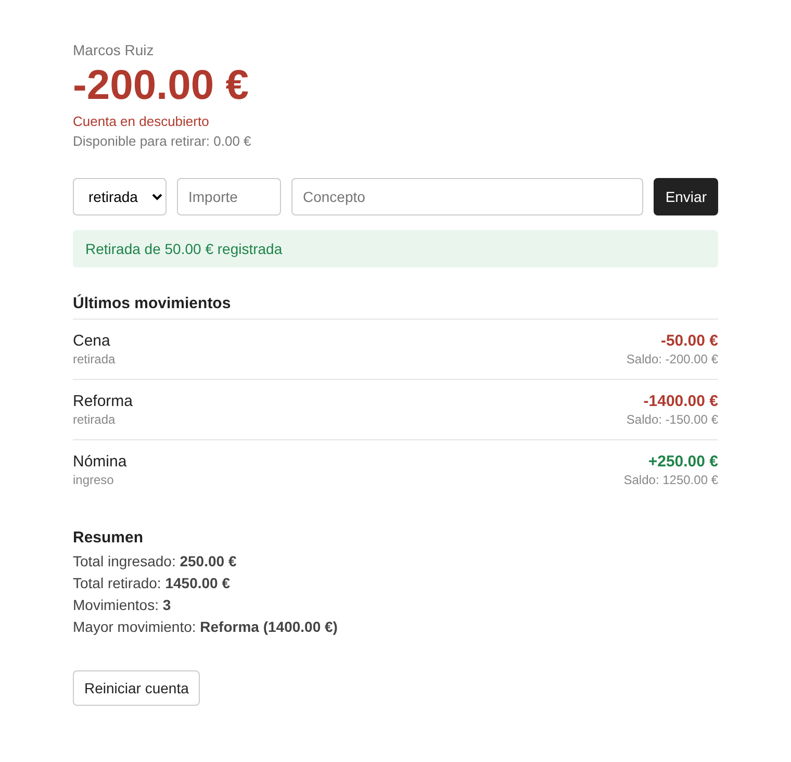

# Ejercicio 4: Cuenta bancaria (3 puntos)

## Descripción

Un banco quiere una pequeña aplicación para que un cliente gestione su cuenta: ingresar y retirar dinero y consultar sus movimientos. No hay base de datos: toda la información se guarda en la **sesión**.

Puedes resolverlo **con funciones o con clases** (por ejemplo, una clase `Cuenta`). La estructura de archivos es la misma en los dos casos. Si decides guardar objetos en `$_SESSION`, la clase debe cargarse con `require` **antes** de `session_start()`, o el objeto no se recupera bien.

---

## Estructura de archivos

```
/EJ4
├── index.php
├── config.php
├── README.md
├── assets/
│   ├── css/
│   │   └── styles.css
│   └── img/
├── partials/
│   ├── header.php
│   └── footer.php
└── controllers/
    ├── operar.php
    └── reiniciar.php
```

Si usas POO, crea además una carpeta `classes/` con tus clases.

---

## Configuración

El archivo `config.php` ya define las constantes de la cuenta:

```php
const TITULAR = "Marcos Ruiz";
const SALDO_INICIAL = 1000;
const DESCUBIERTO_MAXIMO = 200;
const TIPOS_OPERACION = ["ingreso", "retirada"];
```

---

## Funcionamiento

### La sesión

La primera vez que se entra, la cuenta tiene un saldo igual a `SALDO_INICIAL` y ningún movimiento. El saldo y la lista de movimientos se guardan en `$_SESSION`. Cada movimiento guarda su **tipo**, **concepto**, **importe** y el **saldo resultante** tras la operación.

### Formulario (`index.php`)

Un formulario con tres campos que envía por **POST** a `controllers/operar.php`:

- `tipo`: desplegable con "ingreso" y "retirada"
- `importe`: campo numérico que admite decimales
- `concepto`: campo de texto

### `controllers/operar.php`

Solo acepta POST. Si se accede por cualquier otro método, redirige a `index.php` sin hacer nada.

Valida los datos en este orden. Si alguna comprobación falla, guarda un **mensaje flash de error** y redirige a `index.php`:

1. Ningún campo está vacío: "Rellena todos los campos"
2. El tipo es uno de los permitidos: "Tipo de operación no válido"
3. El importe es numérico y mayor que 0: "El importe debe ser mayor que 0"
4. El concepto tiene al menos 3 caracteres, sin contar los espacios del principio y del final: "El concepto debe tener al menos 3 caracteres"
5. Si es una retirada, el saldo resultante **no puede ser inferior a `-DESCUBIERTO_MAXIMO`**: "Fondos insuficientes"

Si todo es correcto, actualiza el saldo, añade el movimiento, guarda un **mensaje flash de éxito** (por ejemplo, "Retirada de 50.00 € registrada") y redirige a `index.php`.

### `controllers/reiniciar.php`

Solo acepta POST. Devuelve la cuenta al estado inicial (saldo inicial y sin movimientos), guarda un mensaje flash de confirmación y redirige a `index.php`.

### Mensaje flash

Cuando un controller termina deja un mensaje en la página principal (de tipo éxito o error). `index.php` lo muestra.

---

## Qué debe mostrar `index.php`

1. El titular y el **saldo actual** con 2 decimales y el símbolo €. Si el saldo es negativo se muestra en rojo con el aviso "Cuenta en descubierto".
2. El **disponible para retirar**: saldo más `DESCUBIERTO_MAXIMO`.
3. El formulario de operaciones.
4. El mensaje flash, si existe.
5. Los **últimos 5 movimientos**, el más reciente primero. De cada uno: concepto, tipo, importe (con `+` si es ingreso y `-` si es retirada) y saldo resultante. Si no hay movimientos, el mensaje "Todavía no hay movimientos".
6. Un **resumen** con el total ingresado, el total retirado, el número de movimientos y el movimiento de mayor importe (concepto e importe). El resumen se calcula con **todos** los movimientos, no solo con los 5 mostrados. Si no hay movimientos, el resumen no aparece.
7. Un botón para **reiniciar la cuenta**, que envía por POST a `controllers/reiniciar.php`.

---

## Diseño orientativo

Así podría verse la página. Es solo una referencia: se pide un diseño sencillo y limpio, y no se valora más allá de que sea legible.



---

## Casos para probar tu aplicación

Parte de la cuenta recién reiniciada (saldo 1000, descubierto máximo 200) y haz estas operaciones en este orden:

| Nº | Tipo | Importe | Concepto | Resultado |
|---|---|---|---|---|
| 1 | ingreso | 250 | Nómina | Correcto. Saldo: 1250.00 € |
| 2 | retirada | 1400 | Reforma | Correcto. Saldo: -150.00 €. Disponible: 50.00 € |
| 3 | retirada | 60 | Compra | Error "Fondos insuficientes". El saldo sigue en -150.00 € |
| 4 | retirada | 50 | Cena | Correcto. Saldo: -200.00 €. Disponible: 0.00 € |
| 5 | ingreso | 0 | Prueba | Error "El importe debe ser mayor que 0" |
| 6 | ingreso | 10 | Ab | Error "El concepto debe tener al menos 3 caracteres" |

Con los movimientos correctos (1, 2 y 4), el resumen debe mostrar: total ingresado 250.00 €, total retirado 1450.00 €, 3 movimientos y el de mayor importe es "Reforma" (1400.00 €).

---

## Requisitos técnicos

- `session_start()` es la **primera instrucción** de cada archivo que use la sesión, antes de cualquier HTML.
- Usa `<?= ?>` para pintar valores y la sintaxis alternativa de PHP (`foreach(): endforeach;`, `if(): endif;`) dentro del HTML.
- La lógica va **antes** del HTML en `index.php`.
- Los controllers no contienen HTML: solo lógica, y terminan con `header("Location: ...")` seguido de `exit()`.
- Los importes se muestran siempre con 2 decimales y el símbolo €.
- Diseño sencillo y limpio. Lo importante es la lógica.

---

## Entrega

Carpeta del ejercicio completa, con `index.php`, `config.php`, `controllers/`, `partials/` y `assets/` (y `classes/` si usas POO).
